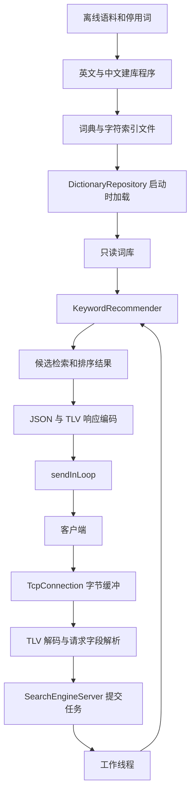

# 搜索引擎项目迭代方案：从离线建库到在线关键词推荐

版本：2.2  
编写日期：2026-10-11  
适用项目：当前 SearchEngine C++11 / CMake / Reactor 工程  
当前阶段：P7 词库整批发布已落地；下一步为检索效果评测与长时压力测试

配套上下文：[search-engine-context.md](search-engine-context.md)。本文负责近期接口、实施与验收；上下文文档负责代码基线和长期演进，二者不将规划当作已实现功能。

本文是后续开发的设计与验收方案。配置、双词库加载、推荐算法与 CLI、两类 TLV 业务协议及正式在线服务已实现。`PageProcessor` 的 XML 提取、去重和 TF-IDF 倒排索引、`WebIndexStore` 的整批发布与加载校验、在线网页余弦查询、`DictionaryStore` 的四文件整批发布与回滚，以及队列 / 线程池非阻塞提交接口也已落地。当前事实依据本次读取的源码和产物。示例代码用于说明接口契约，不是可直接替换现有代码的完整实现。

## 目录

1. [迭代目标与范围](#1-迭代目标与范围)
2. [当前实现与差距](#2-当前实现与差距)
3. [整体架构与模块边界](#3-整体架构与模块边界)
4. [词库加载与编号设计](#4-词库加载与编号设计)
5. [关键词推荐算法](#5-关键词推荐算法)
6. [网络协议与拆包设计](#6-网络协议与拆包设计)
7. [线程模型资源所有权与停服](#7-线程模型资源所有权与停服)
8. [配置目录与构建设计](#8-配置目录与构建设计)
9. [分阶段实施计划](#9-分阶段实施计划)
10. [测试与验收矩阵](#10-测试与验收矩阵)
11. [性能测量与可观测性](#11-性能测量与可观测性)
12. [词库版本发布与回滚](#12-词库版本发布与回滚)
13. [缓存迭代](#13-缓存迭代)
14. [网页搜索后续迭代](#14-网页搜索后续迭代)
15. [关键决策与已知限制](#15-关键决策与已知限制)
16. [开发任务清单](#16-开发任务清单)
17. [源码与资料索引](#17-源码与资料索引)

## 1. 迭代目标与范围

### 1.1 本轮交付目标

完成一个可以端到端运行的关键词推荐服务：客户端发送一个英文、中文或中英混合关键词，服务器从真实词库检索候选，计算 Unicode 编辑距离，按确定的规则返回前 K 个推荐词。

本轮交付包含：

- 运行时配置加载和词库路径解析。
- 中英文词典与字符索引加载、完整性校验、只读共享。
- 关键词归一化、候选检索、去重、编辑距离和 Top K 排序。
- 独立命令行推荐工具，用于脱离网络验证业务算法。
- TLV 消息编解码、请求关联和结构化错误响应。
- 非阻塞任务提交、连接生命周期处理和停服流程。
- 推荐服务及测试客户端。
- 算法、协议、并发和端到端测试。

### 1.2 业务语义

本轮实现的是“相似词推荐 / 拼写纠错”。`helo` 与 `hello`、`中囯` 与 `中国` 都相距 1，但是否进入前 K 仍由同距离词频和 K 决定；在当前真实词库的默认 Top 5 中，`hello` 不在 `helo` 的结果内，`中国` 位于 `中囯` 的第二位。距离为 0 的完全匹配词应排在所有非完全匹配词之前。

前缀补全、拼音纠错、同义词扩展、整句语义理解可以后续增加，但不作为本轮排序规则的一部分。单个关键词推荐直接使用 Unicode 字符序列，在线推荐过程无需调用 cppjieba。

### 1.3 后续阶段

| 阶段 | 目标 | 启动条件 |
| --- | --- | --- |
| 本轮 | 在线关键词推荐闭环 | 已有中英文离线产物 |
| 下一轮 | 词库版本管理已完成；查询缓存待评估 | 推荐结果正确、性能基线已测量 |
| 并行离线 | 网页 TF-IDF 倒排索引和版本仓库 | 已完成 |
| 文档查询 | 候选召回和余弦排序 | 已实现 TLV 类型 2 与查询 CLI |
| 扩展 | 热更新、改进召回与排序、HTTP 接口 | 有相应测试数据和需求 |

## 2. 当前实现与差距

### 2.1 已实现的基础

| 能力 | 当前源码或产物 | 说明 |
| --- | --- | --- |
| 目录扫描 | `src/offlineprocess/DirectoryScanner.*` | 返回排序后的普通文件绝对路径，忽略符号链接 |
| 语料统一入口 | `offlineprocess/corpus/BuildCorpus.cpp` | 两种语言均处理成功后按 generation 发布四份产物 |
| 英文建库 | `offlineprocess/corpus/KeywordProcessor.*` | 小写归一化、停用词过滤、词频与字母索引 |
| 中文建库 | `offlineprocess/corpus/ChineseKeywordProcessor.*` | cppjieba Mix 分词、过滤、词频与字符索引 |
| UTF-8 工具 | `src/offlineprocess/Utf8Utils.*` | utf8cpp 编码校验、字符拆分和码点转换 |
| 网页离线索引 | `offlineprocess/webpage/PageProcessor.*` | tinyxml2 提取、SimHash 去重、网页/偏移库、TF-IDF 倒排索引 |
| 网页版本仓库 | `offlineprocess/webpage/WebIndexStore.*` | generation 发布、清单校验、只读快照与按偏移读取 |
| 在线网页查询 | `offlineprocess/webpage/WebQueryAnalyzer.*`、`WebSearcher.*` | 查询分词、严格交集召回、余弦排序和摘要 |
| Reactor | `src/reactor/` | epoll、连接管理、非阻塞收发和跨线程任务投递 |
| 线程池 | `ThreadPool.*`、`TaskQueue.*` | 有界队列、非阻塞提交结果，停止时排空已提交任务 |
| 配置与词库 | `src/recommendation/` | 强类型配置、路径解析、双词库校验与只读候选仓库 |
| 词库版本仓库 | `src/recommendation/DictionaryStore.*` | 四文件 SHA-256 清单、原子 CURRENT 指针、校验加载与手动回滚 |
| 推荐算法与 CLI | `src/recommendation/`、`bin/recommend_keywords` | 查询归一化、码点编辑距离、完整排序 Top K、JSON 命令行输出 |
| 通用帧与业务协议 | `src/protocol/` | 8 字节 TLV、行帧兼容、类型 1 推荐与类型 2 网页搜索的 JSON 契约 |
| 在线服务 | `src/online/`、`bin/searchengine`、`bin/recommendation_client`、`bin/search_client` | 两类 TLV 请求共用在途编号、非阻塞提交和 Reactor 回传 |
| 服务示例 | `src/reactor/examples/echo/EchoServer.*` | 网络回调读取消息，工作线程执行 Echo |
| 测试注册 | `CMakeLists.txt` | 当前注册 17 个 CTest 测试 |

网页数据和中英文词典均为当前 `data/` 中的实际产物；正式配置使用版本仓库。下列旧四文件仅供兼容入口和单语言工具使用：

| 文件 | 行数 | 含义 |
| --- | ---: | --- |
| `data/en_dict.dat` | 34,705 | 英文词条数 |
| `data/en_index.dat` | 26 | 英文字母索引键数 |
| `data/cn_dict.dat` | 17,315 | 中文词条数 |
| `data/cn_index.dat` | 3,084 | 中文库字符索引键数 |
| `data/keyword_index/generations/<generation>/` | 4 份数据文件 + 清单 | 当前正式中英文词库版本 |
| `data/keyword_index/CURRENT` | 1 | 当前词库版本指针 |
| `data/web_index/generations/<generation>/webpage.dat` | 3,841 | 去重后网页文档数 |
| `data/web_index/generations/<generation>/offset.dat` | 3,841 | 网页偏移记录数 |
| `data/web_index/generations/<generation>/inverted_index.dat` | 97,061 | 网页索引词项数（1,048,882 条 posting） |
| `data/web_index/CURRENT` | 1 | 当前完整网页版本指针 |

当前两份词典共有 52,020 条记录；重新生成后须重新核对，不能硬编码到程序或作为长期验收常量。

### 2.2 必须处理的差距

1. `searchengine` 已启动 `SearchEngineServer` 并加载真实词库；Echo 保留为独立示例。
2. `TcpConnection::dispatchFrames()` 按服务选择行帧或 TLV，正式推荐服务明确选择 TLV 并接入业务回调。
3. Echo 仍调用可能等待队列空位的 `addTask()`；正式推荐服务使用 `tryAddTask()`，队列满直接返回 503，不阻塞 Reactor。
4. `DirectoryScanner` 和 `Utf8Utils` 已由 `searchengine_offline_common` 编译，`searchengine_corpus` 与 `searchengine_webpage` 只依赖该共享目标，两个业务模块不互相链接。
5. `Configuration` 的在线词库、队列和请求限制已由正式服务读取；离线入口仍使用各自默认值或命令行参数。
6. 配置中的旧 `dict_path`、`dict_index_path` 暂留作未来统一产物；当前加载使用独立的中英文路径键。
7. 正式服务已按连接登记在途编号、拒绝重复编号，并允许工作任务乱序完成；客户端按编号关联响应。
8. 正式服务已在管理线程请求排空：先停止接入，Reactor 等待在途请求及输出缓冲排空；期限到达后关闭剩余连接，随后管理线程等待工作线程退出。期限不强制中断仍在执行的 C++11 任务。
9. 网页索引和词库均已按各自 generation 整批发布；在线服务启动时分别校验并加载快照。网页查询支持分词、候选交集、余弦排序和摘要返回。BM25、并集召回、词库与网页热更新尚未实现。

### 2.3 依赖现状

- 当前工程要求 C++11，不采用 C++17 `std::filesystem`、`std::string_view` 等接口。
- 当前已安装 cppjieba、limonp、utf8cpp、tinyxml2 和 simhash，cppjieba 资源在 `/usr/local/dict/`。
- CMake 现已显式检测 nlohmann/json.hpp，并将 OpenSSL Crypto 用于网页和词库版本文件的 SHA-256 校验。
- `docs/模块二/人民网语料/` 中已有 XML 文件，供后续网页搜索使用。

## 3. 整体架构与模块边界

### 3.1 数据流



### 3.2 模块职责

| 模块 | 输入 | 输出 | 责任 |
| --- | --- | --- | --- |
| `Configuration` | 配置文件、命令行覆盖值 | 已校验的 `ServerOptions` | 参数、路径和启动检查 |
| `DictionaryRepository` | 多份词典与索引路径 | 只读词条、候选编号 | 数据加载、校验和编号归属 |
| `QueryNormalizer` | 原始查询字符串 | 小写归一化文本、码点序列 | 输入契约和 Unicode 校验 |
| `EditDistance` | 两个码点序列 | 非负编辑距离 | 纯计算 |
| `KeywordRecommender` | 查询、K、只读词库 | 有序推荐结果 | 检索、去重、距离和 Top K |
| `FrameCodec` | 连接字节缓冲 | 完整帧或解码状态 | TLV 边界、长度和网络字节序 |
| `RecommendationProtocol` | 帧正文或业务结果 | 请求对象或响应帧 | JSON 字段及错误协议 |
| `SearchEngineServer` | 请求、连接 | 异步响应 | 调度、负载控制、生命周期 |

`QueryNormalizer` 和 `EditDistance` 初期可作为推荐库内的小组件，不需要额外的继承体系。模块划分主要服务于可测试性，避免类数量超过实际需要。

### 3.3 依赖方向

```text
在线服务层 → 推荐业务库 → 公共 UTF-8 工具
在线服务层 → 业务 JSON 协议 → 通用消息帧
在线服务层 → Reactor / 线程池 → 通用消息帧
离线建库层 → cppjieba / 公共 UTF-8 工具
```

词库加载器和推荐器不持有 `TcpConnection`。消息帧模块不解析推荐业务 JSON。网络层不加载词库。这样命令行推荐工具、协议单测和网络服务可以分别构建和运行。

## 4. 词库加载与编号设计

### 4.1 继续使用两份独立词库

本轮保留：

```text
英文：en_dict.dat + en_index.dat
中文：cn_dict.dat + cn_index.dat
```

每份库有独立的零基编号。候选标识必须携带库来源：

```cpp
struct WordId
{
    std::size_t sourceId;
    std::size_t wordId;
};

struct WordEntry
{
    std::string word;
    std::u32string codePoints;
    std::uint64_t frequency;
};

struct DictionarySnapshot
{
    std::string name;
    std::vector<WordEntry> words;
    std::unordered_map<std::string, std::vector<std::size_t>> characterIndex;
};
```

`WordId` 的相等和去重依据是 `(sourceId, wordId)`。两个词库中的编号 `0` 代表不同词条。统一使用字符串形式的字符键：英文为 `"a"`，中文为 `"中"`。

仓库负责屏蔽编号来源，推荐器通过仓库取得词条，不自行计算中文编号偏移。查询所有已启用词库，能自然覆盖中英混合关键词，避免仅根据第一个字符决定语言。

### 4.2 数据文件契约

词典每行：

```text
word frequency
```

字符索引每行：

```text
character wordId wordId ...
```

读取规则：

- 文件采用合法 UTF-8；输出格式不含空白词条。
- 词频是十进制正整数，读取时检查 `uint64_t` 范围和非法尾随字符。
- 词典编号等于文件行号减一，加载器不能跳过坏行后继续使用旧索引。
- 每个索引键恰好是一个 Unicode 码点。
- 每行索引编号严格递增，属于同一份词库，且小于词条数。
- 编号对应的词条必须包含该字符；完整校验还要检查是否遗漏词条字符。
- 重复词条、重复索引键、非法编码、编号越界应使启动失败。
- 词典允许按当前 `std::string` 字典序输出；该顺序不是拼音排序。
- 当前真实库不为空；若将来需要启用空库，要增加明确策略，而非静默当作成功。

所有索引行使用 `std::getline` 和动态字符串读取。英文常用字母对应的一行可能很长，不应使用固定长度字符数组。

### 4.3 加载流程

```text
解析配置路径
    → 打开各份词典，解析并生成 WordEntry
    → 提前计算每个词的 Unicode 码点
    → 加载索引并检查编号与字符归属
    → 检查索引完整性
    → 发布只读仓库
    → 启动网络监听
```

先使用局部对象完成加载，全部通过后再交给服务。数据出错时报告文件与行号，不启动一个只加载了一半词库的服务。

已实现的接口：

```cpp
class DictionaryRepository
{
public:
    static std::shared_ptr<const DictionaryRepository>
    load(const std::vector<DictionarySource> &sources);

    std::vector<WordId>
    findCandidates(const std::vector<std::string> &characters) const;

    const WordEntry &word(const WordId &id) const;
};
```

### 4.4 词条重复与后续合并

当前英文库只包含 ASCII 英文词，中文库词条必须包含汉字，两者的词条集合按现有处理规则互不重叠。加载同一份词库两次应被配置校验拒绝。

如果后续增加来源导致同词重复，推荐输出先按归一化词语去重，再使用明确的词频合并策略；频率求和需检查溢出。不要重复把同一来源的同一频次加进去。

如果未来生成统一磁盘词典，正确步骤是合并词频、确定最终顺序、统一编号、重新构建字符索引。直接拼接两份索引会产生编号冲突；若改变词典排序，简单加偏移也不够。

## 5. 关键词推荐算法

### 5.1 查询契约

建议首版采用以下规则，最终数值由配置控制：

- 输入为一个关键词，UTF-8 必须合法。
- 去除首尾 ASCII 空白；归一化后不能为空。
- ASCII 大写字母转换为小写。
- 拒绝内部空白和控制字符，多词、整句查询留给后续接口。空白判定使用固定码点集合：U+0009 至 U+000D、U+0020、U+0085、U+00A0、U+1680、U+2000 至 U+200A、U+2028、U+2029、U+202F、U+205F、U+3000；控制字符拒绝 U+0000 至 U+001F 和 U+007F 至 U+009F。不能对 UTF-8 的单个字节调用 `std::isspace` 来判断 Unicode 空白。
- 其余合法码点保留为编辑距离输入，不删除后粘连两侧文本。数字错字如 `hell0` 仍可参与纠错。首版不做完整的 Unicode 字符类别过滤，不能把保留集合称为全部“可打印字符”。
- 默认最大查询长度 64 个 Unicode 码点；长度检查在候选检索之前执行。
- 默认 K 为 5，允许范围为 1 至 20；无效 K 返回参数错误。
- 首版不进行繁简转换、拼音转换、全角转换或 Unicode 规范化等额外规则。

原始查询可用于响应展示；归一化查询用于检索、距离和后续缓存键。查询阶段不要按停用词表把用户输入删空，停用词已经在离线词典中应用。

### 5.2 候选获取

1. 将归一化查询拆分为完整 UTF-8 字符。
2. 对查询中重复字符去重，避免重复访问索引。
3. 查询每份词库的每个字符，合并所有候选 `WordId`。
4. 没有对应索引的字符直接跳过，不能使用 `.at()` 导致异常。
5. 候选按来源和编号去重后进入距离计算。

候选集合是并集，不是交集。对于 `中囯`，即使错字 `囯` 没有索引，仍能通过 `中` 找到 `中国`。

首版可使用 `std::set<std::pair<std::size_t, std::size_t>>` 去重，正确性清晰。性能测量后再考虑每次请求独立的标记数组。不要把可写标记数组放进所有线程共享的只读仓库。

### 5.3 编辑距离

对码点序列 A、B，采用单位代价 Levenshtein 距离：

```text
D[i][0] = i
D[0][j] = j
D[i][j] = min(
    D[i-1][j] + 1,
    D[i][j-1] + 1,
    D[i-1][j-1] + (A[i-1] == B[j-1] ? 0 : 1)
)
```

推荐使用两行动态规划数组，时间复杂度为 `O(|A| × |B|)`，额外空间为 `O(min(|A|, |B|))`。候选词码点已在加载时准备，查询码点每次只生成一次。

首版包含插入、删除、替换，不包含交换相邻字符的独立操作。若以后实现 Damerau-Levenshtein，要更新算法版本和测试预期。

### 5.4 排序与 Top K

```cpp
struct Recommendation
{
    std::string word;
    std::uint64_t frequency;
    std::size_t distance;
};
```

严格排序规则：

1. 编辑距离小的排在前面。
2. 距离相同，词频高的排在前面。
3. 距离和词频都相同，按 `std::string` 字典序升序。

比较器独立实现并测试，保证严格弱序。不要使用 `<=` 比较，也不要以编号替代最后的词语字典序。

首个版本使用全量候选排序，作为正确性基线。若候选数为 M，排序成本为 `O(M log M)`。优化版用大小为 K 的堆维护结果，堆顶应是“当前最差候选”，选择成本为 `O(M log K)`，最后再排序堆中的 K 个结果。

只有堆已满时，才可用长度差剪枝；当 `abs(queryLength - wordLength)` 严格大于当前最差距离时，候选不能进入 Top K。等于该距离时仍可能凭词频或字典序胜出，不能直接跳过。

### 5.5 召回边界

字符索引只覆盖与查询至少共享一个字符的词。输入的每个字符都错了、单字错字或完全不同写法可能得到空候选。

首版返回成功的空数组，不承诺全词典最近邻。后续可增加“候选为空时扫描全词典”等兜底策略，但需独立评估成本和版本化行为。首版不要随意截断候选列表，否则可能遗漏距离更小的词。

当前真实英文库中 `helo` 会召回大量共享字符词，`hello` 词频低；“距离优先、同距词频优先”并不保证常见拼写纠错样例在默认 Top 5 出现。若需要提高纠错效果，应另立排序策略及评测集，不在本基线中偷偷改变权重。

## 6. 网络协议与拆包设计

### 6.1 线格式

采用固定 8 字节消息头加 UTF-8 JSON 正文：

| 字段 | 字节数 | 编码 | 说明 |
| --- | ---: | --- | --- |
| `type` | 4 | 无符号 32 位，大端 | 操作类型与响应标记 |
| `length` | 4 | 无符号 32 位，大端 | 正文的字节长度 |
| `body` | `length` | UTF-8 JSON | 业务字段 |

当前协议类型：

| 类型值 | 含义 | 本轮行为 |
| --- | --- | --- |
| `0x00000001` | 关键词推荐请求 | 支持 |
| `0x80000001` | 关键词推荐响应 | 服务端发送 |
| `0x00000002` | 网页搜索请求 | 支持 |
| `0x80000002` | 网页搜索响应 | 服务端发送 |

低 31 位表示操作，最高位标记响应。客户端不能把响应帧当请求发送。未知有效请求类型可使用对应响应类型返回 `UNSUPPORTED_OPERATION`；无法确认合法帧边界的输入关闭连接。

发送时显式编码两个 `uint32_t`，使用 `htonl` / `ntohl` 转换。不能把包含 `std::string` 的 C++ 结构体直接发到网络，也不能把宿主机 `sizeof(Message)` 当协议头长度。

`length` 按 UTF-8 字节数计算，不按汉字数量计算；TLV 不依赖换行。JSON 中的换行、转义字符和格式化空白不应改变帧边界。

### 6.2 请求字段

```json
{
  "version": 1,
  "request_id": "req-0001",
  "query": "中囯",
  "top_k": 5
}
```

| 字段 | 类型 | 规则 |
| --- | --- | --- |
| `version` | 整数 | 必须为 1 |
| `request_id` | 字符串 | 必填，1 至 64 个 ASCII 字符，允许字母、数字、`-`、`_` |
| `query` | 字符串 | 必填，按推荐查询契约校验 |
| `top_k` | 整数 | 可省略，省略时使用默认值；允许 1 至配置上限 |

请求编号采用字符串，避免客户端大整数表示差异。同一连接尚未完成的请求不能重复使用同一编号。首版拒绝未知业务字段，以便发现拼错字段名；将来修改兼容策略需明确协议版本。

### 6.3 响应字段

以下是协议形状示例，示例词频不是对真实库内容的固定验收要求：

```json
{
  "version": 1,
  "request_id": "req-0001",
  "code": 0,
  "message": "ok",
  "data": [
    {"word": "中国", "distance": 1, "frequency": 30}
  ]
}
```

成功但没有候选时，`code` 为 0、`data` 为 `[]`。结果个数最多为 K，词库候选不足时不补足数量。只返回推荐结果，不向客户端暴露内部词库编号。

当前应用层错误码不是 HTTP 状态码；停服 504 的时序已在 P5 验收：

| 编码 | 名称 | 场景 | 连接处理 |
| ---: | --- | --- | --- |
| 0 | `OK` | 成功，包括空结果 | 保持连接 |
| 400 | `INVALID_REQUEST` | 字段、版本、编码、长度、K 等非法 | 可恢复错误保持连接 |
| 409 | `DUPLICATE_REQUEST_ID` | 同连接未完成编号重复 | 返回错误；客户端必须纠正编号使用 |
| 500 | `INTERNAL_ERROR` | 请求处理发生内部异常 | 尽量返回错误，记录日志 |
| 501 | `UNSUPPORTED_OPERATION` | 本轮未实现的操作类型 | 保持连接 |
| 503 | `SERVER_BUSY` | 队列满、连接在途请求超限 | 保持连接，客户端自行控制重试 |
| 504 | `SERVER_STOPPING` | 服务正在排空任务 | 完成可发送响应后关闭 |

请求编号无法可靠解析时，错误响应中的 `request_id` 为 `null`。畸形长度、客户端发送响应类型等帧级错误关闭连接，避免继续从不可信边界提取数据。

### 6.4 解码状态机

```text
缓冲区不足 8 字节
    → NeedMore，保留全部数据

缓冲区已有头部
    → 解码 type / length
    → 检查类型方向、正文上限和总长度计算
    → 正文未收全：NeedMore
    → 正文收全：提取一个完整帧
    → 消费 8 + length 字节，继续尝试下一个帧
```

`FrameCodec` 提供 `NeedMore`、`FrameReady`、`InvalidFrame` 三种结果。`NeedMore` 不消费缓冲；`FrameReady` 必须准确报告消费字节数。先校验长度上限，再计算总长度、分配正文，避免错误长度触发超大分配。

长度为 0 的帧可被帧层正确提取，但正文层应按无效 JSON 返回参数错误。粘包中的前一帧成功提取后，后一帧可以继续处于半包状态。

### 6.5 与现有连接代码的集成

当前已经采用显式帧策略：`LineFrameCodec` 用于现有 Echo 示例，`TlvFrameCodec` 用于正式推荐服务。由服务创建时选择，连接不猜测协议。`TcpConnection::dispatchFrames()` 在回调前消费帧；业务回调接收完整 `Frame`，不再操作原始接收缓冲。

这样 `echo_server_example` 可保留原来的调试方式，而正式推荐服务使用 TLV。网络库只依赖通用帧类型，JSON 解析由 `RecommendationProtocol` 完成。

## 7. 线程模型资源所有权与停服

### 7.1 线程职责

| 执行位置 | 工作 | 共享策略 |
| --- | --- | --- |
| 启动 / 管理线程 | 加载配置、词库、启动和停服协调 | 初始化后发布只读资源 |
| Reactor 线程 | 接收字节、提取帧、解析受限 JSON 与字段、登记请求、非阻塞提交、实际发送 | 连接缓冲和在途状态由本线程维护 |
| 工作线程 | 查询归一化与码点校验、推荐计算、响应编码 | 只读词库共享，请求状态局部保存 |

首版采用一次业务任务提交。Reactor 只解析不超过 4 KiB 的 JSON，检查字段类型、版本、编号和 K；严格限制嵌套深度，业务字段不允许嵌套数组 / 对象。推荐计算在工作线程完成。JSON 解析耗时应纳入基准；未来正文复杂时再考虑工作线程解析与两段调度，不能在首版混用两套请求计数模型。

当前 `RecommendationProtocol` 在构造 JSON 对象前检查正文大小、UTF-8 和词法嵌套深度，再由 JSON 解析器检查语法及字段；恶意深层输入已有协议单测。默认最大深度为 8，正式服务需从配置传入实际限额。

### 7.2 非阻塞提交

当前已实现：

```cpp
enum class SubmitResult
{
    Accepted,
    QueueFull,
    Stopped,
    InvalidTask
};

SubmitResult TaskQueue::tryPush(Task task);
SubmitResult ThreadPool::tryAddTask(Task task);
```

`tryPush()` 在队列锁内完成“检查容量并插入”，没有条件变量等待。不能先调用 `full()` 再调用阻塞 `push()`，两次操作之间状态可能变化。

已有阻塞 `addTask()` 继续供 Echo 示例和原有测试使用；正式推荐服务只调用非阻塞版本。队列满时立即返回 `QueueFull`，空任务返回 `InvalidTask`；停服并发时，已接纳任务排空，未接纳任务返回 `Stopped`。这里的“非阻塞”是指不等待队列空位，并非无锁算法。

### 7.3 连接与请求限制

建议初值如下。请求与在途限额已在正式服务生效；输入/输出缓冲上限目前是连接实现中的固定常量，完整帧分发预算为代码内的每轮 32 帧：

| 参数 | 建议默认值 | 作用 |
| --- | ---: | --- |
| `max_query_chars` | 64 | 限制编辑距离输入长度，按码点计 |
| `max_top_k` | 20 | 限制结果个数 |
| `max_body_bytes` | 4,096 | 首版推荐请求正文上限 |
| `max_json_depth` | 8 | 限制 JSON 解析嵌套层数 |
| 输入缓冲上限 | 1,048,576 与帧上限加头部的较大者 | 限制连接累计输入缓冲，当前为代码逻辑而非配置键 |
| `max_output_buffer_bytes` | 16,777,216 | 对齐当前输出缓冲上限，保护慢客户端场景 |
| `max_inflight_per_connection` | 16 | 限制单连接未完成请求数 |
| `thread_num` | 4 | 初始工作线程数，由测量调整 |
| `buf_size` | 1,024 | 初始全局队列容量，由测量调整 |

当前配置的 `buf_size` 为 10，当前 Echo 入口硬编码队列为 1,024；正式服务使用配置中的容量。队列容量单位是“等待执行的任务数”，不是 socket 缓冲字节。

数据帧、字节缓冲、请求在途数量分别限制不同资源，不能互相替代。对一个连接的大量完整帧还应设置单次分发预算；达到预算后在 Reactor 自行排队继续处理，避免缓冲里已有帧却永久等待下一次 socket 事件。

### 7.4 请求生命周期与编号登记

1. Reactor 提取帧，检查正文上限、类型和服务状态，解析受限 JSON 与请求字段。
2. 检查同连接请求编号是否重复，以及在途数量是否达到上限；错误直接返回，不登记业务任务。
3. 登记编号并增加计数，非阻塞提交一次推荐任务。
4. 提交失败时立即撤销登记，按队列满或已停止返回错误。
5. 工作线程完成计算和编码，向 Reactor 投递统一完成回调。
6. Reactor 检查连接身份与状态，撤销登记，再发送响应；断开时只清理状态，不写 socket。

编号从登记起到完成回调执行前不得复用。工作线程结束但完成回调尚未执行时，请求仍在途。任意失败和异常路径都必须恰好清理一次，不能让计数变为负数或长期残留。

正文上限限制请求，不直接限制成功响应；当前在线响应编码器单独使用 64 KiB 上限，连接输出缓冲仍有 16 MiB 上限。响应上限尚未做成配置项；通用 TLV 解码器通过参数接受上限，不把 4 KiB 写死在通用帧格式中。

### 7.5 生命周期与跨线程回传

- 服务持有词库和推荐器；推荐任务捕获只读资源的 `shared_ptr`，不依赖未受保护的裸 `this`。
- 任务捕获连接和 Session 的 `weak_ptr`。`TcpConnection::postToLoop()` 已提供受控的完成回调投递入口；`sendInLoop()` 只能发送，不能替代请求状态清理。
- 在 Reactor 的完成回调中统一处理响应、在途计数和请求编号集合，工作线程不直接操作这些状态。
- 完成回调要覆盖成功、查询参数错误、内部异常和连接已断开，避免在途计数只增不减。不能只以 fd 找回连接，须校验连接实例 / 代次，避免 fd 复用后把旧响应发给新连接。
- 连接断开后允许已开始的短计算结束，但丢弃响应；不要仅因为持有 `shared_ptr` 就认为 socket 仍可写。
- 多任务完成顺序可以与接收顺序不同。客户端依据 `request_id` 关联，不要求服务为同一连接额外维护按到达顺序的结果等待队列。

### 7.6 半关闭与停服

`TcpConnection` 现已区分读 EOF 和连接关闭。完整帧继续处理；半帧遇 EOF 关闭连接；已接纳请求完成且输出写完后关闭。读 EOF 后移除读事件，若有待发输出则继续监听写事件。

正式服务的停服状态：

```text
Running → Draining → Stopped
```

1. `SearchEngineServer::stop()` 停止新业务任务，并向 Reactor 投递 `beginDrain()`；Reactor 移除监听 fd 的读事件。
2. 已接受任务继续计算，Reactor 处理完成回调和输出；已有连接上的新请求返回 504。
3. 所有会话在途集合与全部连接输出缓冲都排空时，或 `shutdown_drain_timeout_ms` 到达时，Reactor 关闭剩余连接并退出循环。
4. `SearchEngineServer::start()` 返回前由管理线程调用 `ThreadPool::stop()`，等待已接纳任务退出；不在 Reactor 中阻塞 `join()`。

工作线程完成不等于响应已经写入 socket；判断排空需同时考虑待执行完成回调和连接输出缓冲。超过排空期限可关闭慢连接，但 C++11 不能安全强杀仍执行的 `std::thread`。资源销毁仍必须等待任务退出，后续可增加合作式取消。

正式入口阻塞 SIGINT / SIGTERM，由独立线程读取 `signalfd` 并调用 `stop()`；信号处理路径不执行 JSON 或线程 `join()`。

## 8. 配置目录与构建设计

### 8.1 拟新增目录

```text
src/
├── common/
│   └── Utf8Utils.h / Utf8Utils.cpp
├── offlineprocess/
│   ├── corpus/                     当前语料、词典和字符索引模块
│   ├── webpage/                    当前网页库和偏移库模块
│   ├── DirectoryScanner.*          当前共享目录扫描
│   └── Utf8Utils.*                 当前共享 UTF-8 工具
├── recommendation/
│   ├── Configuration.h / Configuration.cpp       当前已实现
│   ├── DictionaryRepository.h / DictionaryRepository.cpp
│   ├── DictionaryRepositoryTest.cpp                 当前已实现
│   ├── QueryNormalizer.h / QueryNormalizer.cpp
│   ├── EditDistance.h / EditDistance.cpp
│   ├── KeywordRecommender.h / KeywordRecommender.cpp
│   └── RecommendMain.cpp
├── protocol/                   当前已实现
│   ├── FrameCodec.h / FrameCodec.cpp
│   └── RecommendationProtocol.h / RecommendationProtocol.cpp
├── online/
│   ├── SearchEngineServer.h / SearchEngineServer.cpp
│   ├── Main.cpp
│   └── RecommendationClient.cpp
└── reactor/                    现有网络框架、tests/ 和 examples/echo/

tests/
├── recommendation/
├── protocol/
├── online/
└── fixtures/                   独立小词典，不与真实语料频率绑定

doc/
└── 搜索引擎项目迭代方案.md
```

离线代码已经按 `corpus` 与 `webpage` 两个模块拆分，公共文件仍位于 `offlineprocess` 根目录，并由独立目标统一编译。若以后将 `Utf8Utils` 移到全局 `src/common/`，需同步更新两个模块的 include、CMake 源列表和现有测试。保留已有 Echo 示例独立入口，正式 `searchengine` 切换到 `src/online/Main.cpp`。后续新增在线测试优先放在 `tests/`；现有离线测试与其模块源码放在一起。

### 8.2 当前 CMake 目标

| 目标 | 内容 | 依赖 |
| --- | --- | --- |
| `searchengine_offline_common` | 当前目录扫描与 UTF-8 公共工具 | utf8cpp |
| `searchengine_corpus` | 当前中英文语料、词典与字符索引 | offline_common、cppjieba |
| `searchengine_webpage` | 当前 XML 提取、SimHash 去重与网页库 | offline_common、tinyxml2、simhash |
| `searchengine_recommendation` | 配置、词库版本发布 / 加载与推荐算法 | offline_common、OpenSSL Crypto、nlohmann-json |
| `searchengine_framing` | 通用帧、行协议和 TLV | 标准库 |
| `searchengine_protocol` | 推荐 JSON 请求与响应 | framing、nlohmann-json |
| `searchengine_net` | Reactor 和线程池 | framing、Threads |
| `searchengine_online` | 配置和应用调度 | recommendation、protocol、net |
| `searchengine` | 正式服务入口 | online |
| `recommend_keywords` | 已实现命令行推荐入口 | recommendation、配置加载、nlohmann-json |
| `recommendation_client` | TLV 测试客户端 | protocol |

cppjieba 依赖保留在离线分词目标中。若支持“仅构建在线服务”，需将 cppjieba 查找和资源检查移入离线构建选项；当前 CMake 的依赖检查是全局执行，尚未支持此能力。

JSON 可优先使用官方 CMake 包目标；包配置不可用时用 `find_path(nlohmann/json.hpp)` 建立明确的接口目标。固定或记录依赖版本，避免不同开发环境使用不同 JSON 行为。

### 8.3 配置约定

运行时的相对路径以配置文件所在目录为基准，绝对路径直接使用。配置在解析后转成强类型 `ServerOptions`，业务代码不反复查询字符串 map。

下列配置键已由 `Configuration` 解析并验证，正式在线服务已读取；配置 `keyword_index_root` 时优先加载该目录的 `CURRENT`，四条旧词库路径只在未配置版本根目录时使用。`shutdown_drain_timeout_ms` 控制连接与响应排空期限：

```ini
keyword_index_root = ../data/keyword_index
en_dict_path = ../data/en_dict.dat
en_dict_index_path = ../data/en_index.dat
cn_dict_path = ../data/cn_dict.dat
cn_dict_index_path = ../data/cn_index.dat

server_ip = 0.0.0.0
server_port = 8888
thread_num = 4
buf_size = 1024

default_top_k = 5
max_top_k = 20
max_query_chars = 64
max_body_bytes = 4096
max_json_depth = 8
max_inflight_per_connection = 16
shutdown_drain_timeout_ms = 5000
```

5 秒是连接排空期限建议值，不是线程能够被强制终止的保证。

配置解析检查：缺失必要键、重复键、数值溢出、非法端口、零线程数、零队列容量、K 上下限关系和文件路径。命令行覆盖值优先于文件，但最终统一校验。配置中的缓存和网页搜索参数在相应功能启用时再读取。

### 8.4 用户入口

现有命令，从项目根目录执行：

```bash
cmake -S . -B build
cmake --build build --parallel 2
ctest --test-dir build --output-on-failure
./bin/build_english_keywords
./bin/build_chinese_keywords
```

当前可运行的推荐命令：

```bash
./bin/recommend_keywords --config conf/myconf.conf --query helo --top-k 5
```

当前可运行的在线命令（开发环境建议绑定回环地址）：

```bash
./bin/searchengine --config conf/myconf.conf --host 127.0.0.1
./bin/recommendation_client --host 127.0.0.1 --port 8888 --query 中囯 --top-k 5
```

客户端应负责组装 TLV，读取完整响应并依据请求编号匹配结果。简单地用 `echo query | nc` 不足以测试正式 TLV 服务。

## 9. 分阶段实施计划

以下阶段同时标明已完成基线和后续顺序。每阶段应能独立验证，避免把业务算法、协议和网络生命周期同时改完才首次测试。

### P0：固定基线与公共工具

涉及 `CMakeLists.txt`、`src/offlineprocess/` 的共享工具和两个业务模块。

1. 记录当时的构建参数、十项测试、离线产物格式与数量快照；P3 后增至十三项，P4 后增至十四项。
2. 建立 `searchengine_offline_common`，统一编译目录扫描与 UTF-8 工具。
3. 语料和网页库分别链接公共目标，避免重复编译实现和业务模块间依赖。
4. 补 UTF-8 校验与码点转换测试，覆盖非法序列和补充平面汉字。

完成条件：现有测试保持通过，离线产物业务格式不变，公共工具不依赖网络或 cppjieba。

### P1：配置与词库加载

配置解析和 `DictionaryRepository` 已实现，配置中已补英文路径，现有语料组织方式未改变。

1. 明确配置文件目录基准、覆盖优先级、必需键与数值范围。
2. 加载中英文词典和字符索引，以 `(sourceId, wordId)` 保存来源。
3. 校验编码、频率、编号、字符归属和索引完整性。
4. 对每个词条预生成码点序列，成功后发布只读对象。
5. 为错误报告加入文件路径、行号和具体原因。

完成条件：加载真实四份文件；坏库或坏配置不能启动服务；从不同工作目录使用同一配置文件仍定位到同一数据。

### P2：推荐算法与命令行工具

`QueryNormalizer`、`EditDistance`、`KeywordRecommender` 和 `recommend_keywords` 已实现，以下为已完成的功能基线。

1. 先通过独立小词典验证归一化、候选并集、跨来源编号与距离。
2. 用完整候选排序实现基线，固定距离 / 频率 / 字典序规则。
3. 补空结果、K 边界、中文错字、数字错字及混合词测试。
4. 命令行输出确定的结构化结果，能脱离网络复现一次查询。
5. 在真实库做人工冒烟检查，不把某个真实词频写入长期单元测试。

完成条件：CLI 可加载真实库推荐；比较器和码点距离测试通过；推荐库不包含 socket、JSON 帧或 cppjieba 对象。

### P3：帧协议与请求契约

通用帧、推荐 JSON 协议和连接帧策略已实现；在线业务由 P4 接入。

1. 实现固定 8 字节头、网络字节序、长度检查和三态解码。
2. 以逐字节输入验证所有半包边界，再验证多帧粘包。
3. 实现受限 JSON 解析、版本 / 类型 / 编号 / K 校验和错误编码。
4. 给 Echo 保留行协议策略，推荐服务显式选择 TLV 策略。
5. 已以 `dispatchFrames()` 替代旧的按行消息提取，在回调前消费帧且只消费一次。

完成条件：协议单测不需要启动服务；Echo 仍可用原行协议；畸形长度不会先分配大内存；消息正文含换行不影响 TLV 边界。

### P4：调度与正式服务

已完成，涉及 `TaskQueue`、`ThreadPool`、`TcpConnection`、`EventLoop`、新服务及入口。

1. 队列非阻塞提交结果已实现，原阻塞接口保持不变；正式服务接入时验证结果处理。
2. 接入请求登记、连接在途上限、全局队列容量和分发预算。
3. 暴露受控的业务完成回调投递方式，使用现有 eventfd 唤醒。
4. 完成成功、异常、队列满、连接断开与 fd 复用的清理路径。
5. 替换正式 `searchengine` 入口，保留独立 Echo 可执行文件。
6. 完成客户端，支持一条连接多请求及乱序响应关联。

完成条件：端到端结果与 CLI 对同一输入一致；队列满时立即给出繁忙响应；工作线程不直接修改连接缓冲或请求集合。

以下是本阶段的实际实施路径：

1. 在 `src/online/SearchEngineServer.*` 中持有配置、只读词库、推荐器、`ThreadPool` 与 `TcpServer`。启动时一次性加载并校验词库，构造 `ProtocolLimits`，以 `FrameMode::Tlv` 和 `max_body_bytes` 创建服务；启动失败不得留下半启动线程。Echo 仍保留独立入口。
2. 在 Reactor 线程的 `TcpFrameCallback` 中调用现有 `RecommendationProtocol::decodeRequest()`；可恢复的字段错误按协议编码响应，帧级错误继续由连接层关闭。每个连接维护在途编号集合，不只以 fd 作为请求身份；检查重复编号和 `max_inflight_per_connection` 后再登记。
3. 登记后只调用 `ThreadPool::tryAddTask()`。`Accepted` 保留登记；`QueueFull`、`Stopped`、`InvalidTask` 立即撤销登记并分别构造稳定的错误响应。不得在 Reactor 回调里调用仍会等待队列空位的 `addTask()`。
4. 工作任务只持有请求值、只读词库/推荐器所需资源与弱连接引用。将推荐结果转换为 `ProtocolResponse`；查询校验异常转 400，内部异常转 500。补一条受控的完成回调投递 API，将响应或失败结果送回 `EventLoop::queueInLoop()`；实际发送和登记清理均在 Reactor 线程执行。任务不能捕获可能先析构的服务裸指针。
5. 在完成回调中校验连接实例仍存活且编号仍登记，先恰好撤销一次登记，再调用连接发送接口。`onClose` 释放该连接的登记；旧任务即使完成，也不得因 fd 被复用而写入新连接。多请求允许乱序完成，响应 `request_id` 必须保留原值。
6. 增加单轮 32 帧分发预算和自唤醒续处理，避免一批粘包长期独占 Reactor；已测试队列积压、批量帧和过量在途请求。慢读客户端与输出排空留待 P5；若将硬编码缓冲上限改为配置项，先补配置校验与边界测试。
7. 用 `src/online/Main.cpp` 替换正式 `searchengine` 的 Echo 启动路径，并新增 `recommendation_client`。客户端显式编码 TLV、持续读取完整响应帧、按 `request_id` 匹配多请求结果，不假定响应顺序等于发送顺序。

在线测试覆盖真实词库排序、拆包、多请求、重复编号、繁忙与错误分支、断连和 fd 复用；P5 又覆盖半关闭后响应、残缺帧 EOF、慢读缓冲写出、停服排空、超时断连及 SIGTERM 退出。性能报告见 [推荐服务性能基线](推荐服务性能基线.md)。

### P5：生命周期验收与性能基线（已落地）

1. 区分读 EOF、完整断开和输出排空，验证发送后 `shutdown(SHUT_WR)` 的客户端仍能读响应。
2. 实现 `Running → Draining → Stopped`，管理线程负责等待工作线程，Reactor 保持回传能力。
3. 增加慢读客户端、断连、超限、停服期间连接和请求的测试。
4. 记录吞吐、延迟分位、候选规模、队列等待和内存，形成可复现报告。
5. 基线正确后再对照优化 Top K 堆或增加缓存，不把多项优化混在同一次比较中。

当前 17 项 CTest 通过，排空期限与信号退出有回环测试；已记录推荐与网页查询两组 Debug 构建的本机基线。长时压力测试、内部队列等待与排序耗时采样尚未执行，不能由这组结果推断生产环境容量。

### P6：在线网页查询（已落地）

1. 提取网页建库与在线查询共用的文本清洗、cppjieba Mix 分词和停用词逻辑；共享分词器串行保护 `Cut()`。
2. 加载已校验的 `WebIndexSnapshot`，核对建库与服务的 cppjieba 资源和停用词文件指纹；不匹配时拒绝启动，避免静默改变词项口径。
3. 查询按建库公式 `TF * log2(N/DF)` 形成 L2 归一化向量；所有词项采用严格 posting 交集，按余弦点积分数降序、文档编号升序排序。未知词产生空结果。
4. 仅对 Top K 文档按偏移读取网页库，返回文档编号、标题、URL、去 HTML 的摘要和分数；查询全部被过滤时返回 400。
5. TLV 类型 2 走独立 `SearchProtocol`，但与类型 1 共用 Reactor、线程池、在途编号、背压和停服逻辑。`search_client` 支持多次 `--query`。性能数据见[网页搜索性能基线](网页搜索性能基线.md)。

### P7：关键词词库整批发布与回滚（已落地）

1. `build_corpus` 默认向 `data/keyword_index` 发布一个新 generation，四份词典 / 索引文件在同一暂存目录写完并严格加载校验。
2. `manifest.json` 记录格式版本、generation、四文件大小与 SHA-256、两种语言词条数，以及语料、停用词和 cppjieba 资源的输入指纹；发布前同步文件与目录，再原子替换 `CURRENT`。
3. 正式服务和推荐 CLI 通过 `keyword_index_root` 读取同一当前版本；旧四路径仅在未配置版本根目录时作为兼容入口。服务启动后持有只读快照，切换 `CURRENT` 不会自动热更新。
4. `manage_keyword_index` 可验证当前版本，也可校验旧 generation 后切换指针以回滚；旧版本不自动清理。`dictionary_store_test` 覆盖发布失败不切换、文件损坏拒绝加载、无效指针及回滚。

下一步优先补网页标注查询集与长时压力测试，再比较并集召回、BM25、缓存或热更新。

## 10. 测试与验收矩阵

### 10.1 业务与数据单测

| 范围 | 必测输入 / 场景 | 验收结果 |
| --- | --- | --- |
| UTF-8 | ASCII、常用汉字、补充平面码点、截断 / 过长序列 | 码点数正确，非法输入明确失败 |
| 配置 | 相对路径、缺键、重复键、坏端口、溢出、零容量 | 定位稳定，启动前失败并指出键 |
| 词典 | 正整数频率、坏行、重复词、非法编码、溢出 | 编号不偏移，不跳过错误行 |
| 字符索引 | 长行、越界编号、重复编号、乱序、缺失 / 错误归属 | 所有格式和一致性错误被拒绝 |
| 来源编号 | 中英文各自的 0 号词都被召回 | 两个候选不会因编号相同被误去重 |
| 归一化 | ` HELLO `、空串、内部空白、全角空白、控制码点 | ASCII 小写、长度按码点、错误规则确定 |
| 编辑距离 | 相等、空序列、插删改、中文错字、相邻交换 | 单位代价；`helo` 到 `hello` 为 1，`ab` 到 `ba` 为 2 |
| 候选召回 | 查询重复字符、缺失字符、无共享字符 | 并集去重；缺键不抛异常；无候选返回成功空结果 |
| 排序 | 距离不同、距离相同频率不同、最后字典序比较 | 严格弱序，重复执行结果稳定 |
| Top K | K 为 0、负数、上限外、候选少于 K | 非法 K 被拒绝，不补造结果 |
| 优化等价 | 长度差等于堆阈值、随机小词典 | 优化结果逐项等于完整排序基线 |

空序列是 `EditDistance` 的底层算法测试；业务归一化后的空查询仍然拒绝。相邻交换示例防止误把普通 Levenshtein 当作 Damerau-Levenshtein。

测试 fixtures 独立存放，包含明确词条、词频与索引。比如将 `hello` 与 `help` 设为相同距离但不同频率，专门检查第二排序键；再加入同距离同频率词检查第三排序键。

参考实现应遍历“同一个候选集合”并完整排序，才能检查优化等价。对全词典遍历的结果不同，可能来自字符召回边界，不应直接判断为 Top K 算法错误。

### 10.2 协议与网络测试

| 场景 | 重点 |
| --- | --- |
| 头部每个切分点、正文逐字节到达 | `NeedMore` 不消费数据，收全后只分发一次 |
| 多帧一次写入、完整帧加下一帧片段 | 循环提取正确，未完成尾部保留 |
| JSON 正文含换行、转义和中文 | 边界只由长度决定，长度按字节 |
| 未知操作、客户端发送响应类型 | 应用级不支持与帧级断开区分 |
| 超长长度、零正文、深层 JSON、非法 UTF-8 | 限制在分配 / 递归前或受控解析中执行 |
| 错误字段、未知字段、坏版本、坏 K | 错误码、编号关联和连接处理符合契约 |
| 同连接编号重复、请求乱序完成 | 重复编号拒绝，正常结果由编号关联 |
| 一个连接突发大量完整帧 | 分发预算不饿死其他连接，剩余帧主动续处理 |
| 多连接并发推荐 | 结果与 CLI 一致，无共享可变推荐状态 |
| Echo 回归 | 原行协议和原独立示例入口仍可使用 |

并发与拆包用可控客户端实现，不能依赖 TCP “恰好按发送次数分包”。纯帧测试直接喂不同片段；网络测试关注完整字节流结果。

### 10.3 生命周期与负载测试

- 用可控阻塞任务填满小队列，验证 `tryAddTask()` 不等待；分别覆盖未启动、运行、排空和停止状态。
- 一条连接达到在途上限后立即返回繁忙，不影响其他连接。
- 推荐任务运行时断开客户端，响应丢弃且登记清理；重新建立连接复用 fd 不接收旧响应。
- 客户端只关闭写方向时，已接收完整请求仍得到响应；EOF 后残留半帧按协议错误关闭。
- 客户端不读或极慢读取时，输出缓冲受限，不无限积压。
- 发起停服时停止接收新业务，已接收任务和完成回调排空；没有 Reactor 中阻塞 `join()`。
- 慢连接超过排空期限可被关闭；仍执行的线程正常退出后才销毁其使用的资源。
- 业务任务抛异常时返回或记录内部错误，不使工作线程悄然退出，也不遗留在途计数。

接口级非阻塞测试不能单靠一个很小的耗时阈值判定，通过同步屏障使消费者暂时不能腾出空位，证明提交调用在消费者释放前已经返回。

### 10.4 构建验证与工具

四项现有测试属于回归集合，新测试按目标加入 CTest。普通 Debug 构建先通过，再使用独立构建目录做 ASan / UBSan；TSan 单独运行并记录第三方库或环境限制。不能将互不兼容的 sanitizer 混在一次构建中。

网络测试使用回环地址、可分配端口和明确超时，失败时保留服务日志并清理本测试启动的进程。若沙箱禁止创建 socket，应明确说明该项未执行并请求必要授权，不把环境阻止当成业务测试通过或擅自修改主机安全配置。

## 11. 性能测量与可观测性

### 11.1 基准分层

1. **加载基准**：四份文件的读取 / 校验耗时、词条和 postings 总数、加载前后内存。
2. **算法基准**：无网络、无缓存，记录归一化、召回、距离和排序耗时。
3. **网络基准**：固定查询集与并发，记录端到端延迟、吞吐、拒绝和错误。
4. **优化对照**：只改变一项，例如完整排序换 Top K 堆、增加缓存或调整工作线程数。

查询集至少含英文高频单字符、英文长词、中文常用单字、多字错词、无候选、混合词、最大允许长度。记录每次候选数和候选词长度，不能只测一个容易命中的英文词。

### 11.2 记录指标

| 指标 | 用途 |
| --- | --- |
| p50 / p95 / p99 延迟、吞吐 | 衡量典型与尾部体验 |
| 候选数、DP 处理码点数量、排序耗时 | 区分召回和计算瓶颈 |
| 队列深度、队列等待、拒绝次数 | 判断背压和线程容量 |
| 活跃连接、在途请求、输入 / 输出积压 | 判断连接资源与慢客户端影响 |
| JSON 解析耗时、Reactor 单轮耗时 | 验证轻量解析和分发预算 |
| CPU、RSS、加载时间 | 衡量数据和并发的成本 |
| 业务错误 / 内部异常 / 协议断开数 | 防止吞吐提高只是大量拒绝请求 |

日志建议包含请求编号、连接实例标识、词库版本、结果数、候选数、队列等待和计算耗时。不要默认记录完整查询正文；输入可能含个人信息。同步日志也可能阻塞 Reactor，需受限或异步处理。

### 11.3 报告与优化准入

报告保存至 `doc/`，记录机器、编译模式、依赖版本、数据指纹、配置、查询集、并发、运行时长、预热方式和错误率。区分服务内处理耗时与客户端观察到的端到端耗时。

目前没有真实 QPS / 延迟目标，不能凭架构图宣称“高性能”。先获得基线，再给出可验证预算。缓存、Multi-Reactor、候选剪枝都需要与基线比较正确性和收益；首版不得通过任意截断候选来掩盖计算成本。

## 12. 词库版本发布与回滚

### 12.1 当前发布语义

旧的单语言 `store()` 仍分别替换词典和索引，只用于局部开发与兼容路径。正式完整建库入口 `build_corpus` 则将四份文件写入同一个暂存 generation，严格加载并校验清单后，才原子切换 `CURRENT`。失败不会让正式服务读到部分新文件。

### 12.2 已实现的版本目录与校验

```text
data/keyword_index/
├── CURRENT                   # 当前 gen-XXXXXX 名称，原子替换
├── PUBLISH.lock              # 发布和回滚串行化
└── generations/
    └── gen-XXXXXX/
        ├── en_dict.dat
        ├── en_index.dat
        ├── cn_dict.dat
        ├── cn_index.dat
        └── manifest.json
```

清单记录格式版本、generation、四份文件的大小和 SHA-256、中英文词条数，以及语料、停用词和 cppjieba 资源的输入路径 / 大小 / 指纹。启动时读取一次 `CURRENT`，验证版本名、清单、四份文件和词典索引语义一致性；不重新比对当前外部输入文件，因为版本本身是独立快照。构建时间、索引键数、过滤规则及算法版本尚未写入清单，未来若改变文件语义须升级格式版本。

发布使用同目录暂存、文件与目录同步、原子 `rename()` 及父目录同步。`keyword_index_root` 是正式服务的优先配置；未配置时才使用四条旧路径。网页索引另用 `web_index_root`，两套指针互不关联。断电一致性还需专门故障注入验证。

### 12.3 回滚与未来热更新

运行 `./bin/manage_keyword_index [index_root]` 可验证并查看当前版本；`./bin/manage_keyword_index --activate gen-XXXXXX [index_root]` 会先校验指定版本，再切换指针。旧 generation 默认保留，回滚后需重启在线服务；运行中的服务仍持有启动时加载的快照。未来热更新由后台加载完整新仓库，校验成功后发布只读共享指针，老请求继续持有旧快照；加载失败仍使用旧快照并报告错误。

热更新期间会同时占用两份词库内存，需测量峰值。缓存键携带 generation，避免旧结果污染新库。不直接覆盖被运行中服务视为同一版本的文件；不自动删除仍被服务使用的版本，清理旧版本需独立且可恢复的流程。

## 13. 缓存迭代

### 13.1 何时引入

推荐闭环正确且重复查询存在可测收益时引入，顺序建议为进程内有界缓存，再按多进程共享需求考虑 Redis。缓存失败不能使本来可计算的查询不可用。

### 13.2 缓存键与值

键至少包含：词库 generation、归一化规则版本、排序 / 召回算法版本、归一化查询、K。拼接键时使用无歧义编码，不简单串联未分隔的字段。

值保存推荐结果，而非带 `request_id` 的完整响应帧；命中后用本次编号重新编码。缓存成功空结果可以减少无候选重复计算；参数错误、繁忙、停服和内部错误不按成功业务结果缓存。

### 13.3 并发与失效

首版缓存可使用有界 LRU，短临界区保护查找和淘汰；计算在锁外。限制项数和估算字节数，避免一条大结果使内存边界失效。TTL、命中率、淘汰数和重复计算应可观测。

当前线程池没有业务 worker 编号和缓存同步机制，不因为配置提到“每线程 LRU”就默认已经具备。线程局部缓存可以后续对照测量，但复制多份缓存和周期合并都增加一致性复杂度，非首版必要条件。

Redis 若使用同步客户端，在工作线程或独立缓存执行器访问，必须有连接 / 命令超时与失败回退；不在 Reactor 阻塞等待。并发复用连接的规则以选用库的实际接口为准，不共享一个未证明线程安全的连接。

词库更新通过 generation 失效，而不是让所有查询在一个全局锁下清空缓存。落盘缓存需版本、完整性校验和可丢弃策略，不能成为启动正确性的唯一来源。

## 14. 网页搜索后续迭代

### 14.1 离线数据链路

复用 `docs/模块二/人民网语料/` XML，分阶段实现：

```text
XML 读取 → URL / 标题 / 正文提取 → 清洗与去重
    → 稳定文档编号 → 网页库 + 字节偏移库
    → cppjieba 分词与停用词过滤
    → TF / DF / 文档长度统计
    → 词项到文档的倒排索引及权重
```

离线流水线已经完成。实现使用小 XML fixture 验证 `content` 优先、`description` 回退、缺正文忽略、完全重复、空正文、XML 转义和逐字节偏移；随后处理 37 个真实 XML 文件。4,365 个 item 中提取 4,315 个，忽略 50 个，按 SimHash 汉明距离不超过 3 去掉 474 个，输出 3,841 篇连续编号文档。该阈值来自项目要求，当前没有人工标注集证明其误判率。

网页库保留正文 HTML 原文并由 tinyxml2 转义；索引分支将标签和实体替换成边界，保留标题与正文中的汉字和小写 ASCII 字母，用 cppjieba Mix 分词并过滤中英文停用词。TF-IDF 固定为 `TF * log2(N/DF)`，逐文档 L2 归一化。当前 `data/web_index/generations/<generation>/inverted_index.dat` 含 97,061 个词项和 1,048,882 条 posting。`WebIndexStore` 对三份文件执行 SHA-256、偏移/XML、posting 编号与权重归一化校验，校验后才切换 `CURRENT`。加载器只读取一次版本指针并返回持有网页文件描述符的快照；正式服务启动时加载快照并校验当前分词资源指纹。

在线分词复用 `TextAnalyzer`，其共享 cppjieba 对象在 `Cut()` 周围加互斥锁；此锁也是当前并发吞吐的潜在瓶颈。HTML 清洗目前是确定性的轻量规则，并非完整浏览器 DOM 可见文本算法；改变规则须重新生成和版本化索引。

### 14.2 在线文档查询

首个文档检索基线已实现 TF-IDF 与余弦相似度，固定文档 / 查询向量归一化和 IDF 公式。当前使用包含全部查询词的候选交集；若改成并集召回，要作为明确的检索策略变更并比较效果。

在同一数据集和标注查询上增加 BM25 对照，保存 DF、文档长度和平均文档长度等必要统计。推荐词库的全局词频不能代替这些量。

网页查询使用独立请求 / 响应模型，返回文档编号、标题、URL、摘要和评分；它不是关键词推荐响应多加几个字段。TLV 类型 2 已复用分发、线程池和生命周期框架；若未配置网页索引根目录，该操作返回 501。

### 14.3 HTTP 与现代检索扩展

当浏览器接入明确需要时增加 HTTP Adapter，不把业务实现放在 Router 或连接读事件。只有单 Reactor 的 IO / 调度成为实际瓶颈时再考虑多 IO Reactor，计算瓶颈不会自动因增加 IO 线程而消失。

向量索引、Hybrid / RRF、Reranker、RAG、MCP 属于长期可选演进，见上下文文档。先有可靠文档检索、效果数据与稳定业务 API，再增加外部协议或模型依赖；本轮不安装这些组件，也不创建对应空目录。

## 15. 关键决策与已知限制

| 决策 | 原因 | 暂不承诺的能力 |
| --- | --- | --- |
| 保持 C++11 | 与实际构建和代码一致 | 不照搬 `shared_mutex`、`filesystem` 或较新原子共享指针接口 |
| 双词库只读仓库 | 直接消费现有产物，保留来源编号 | 首版不生成统一磁盘词典 |
| 字符并集召回 | 复用现有索引，允许部分错字 | 不保证全词典全局最近邻 |
| 单位代价码点编辑距离 | 规则清晰，可独立验证 | 不做拼音 / 形近权重或字素簇距离 |
| 完整排序后再优化 | 建立可比较正确性基线 | 不用任意候选截断提速 |
| 单 Reactor + Worker | 复用现有运行模型 | 不预先引入 Multi-Reactor |
| TLV / JSON | 对齐课程并解决消息边界 | 首版不是 HTTP / TLS 服务 |
| Reactor 解析受限请求 | 简化编号登记与一次提交 | 不解析任意大 JSON 或执行耗时检索 |
| 非阻塞队列提交 | 队列满不阻塞网络循环 | 不无限缓存待执行任务 |
| 文件先行、缓存后置 | 首先验证业务闭环 | 不把 Redis / MySQL 当启动前提 |

码点编辑距离不等于用户可见字素距离；组合字符、Emoji 序列、全角 / 繁简和 Unicode 规范化尚未统一。字典序是当前 UTF-8 字符串顺序，不是拼音或地区化顺序。

现有中文建库按文本行处理，语料中的标题 / 分类等元信息尚未专门剔除；词频反映当前输入与过滤规则。优化语料清洗属于独立数据迭代，需重新建库与发布版本，不在实现在线推荐时默默改变已有统计口径。

首版没有认证、TLS 或面向公网的防滥用能力。端到端开发和压力测试优先绑定 `127.0.0.1`；配置中的 `0.0.0.0` 不应被当作可安全直接暴露公网的部署方案。

## 16. 开发任务清单

所有未勾选项均为计划，不表示已有实现。

- [x] 提取 `searchengine_offline_common` 并复用共享扫描和 UTF-8 工具。
- [x] 使用 tinyxml2 提取 item，并实现 content 优先与 description 回退。
- [x] 使用 SimHash 汉明距离阈值 3 去重，生成网页库与字节偏移库。
- [x] 增加网页处理 fixture 测试并处理完整 XML 语料。
- [x] 按 generation 发布网页三份文件，写入清单并实现启动加载校验。
- [x] 增加配置解析、强类型选项及英文产物路径。
- [x] 实现双词库严格加载与只读仓库。
- [x] 实现查询归一化与单位代价码点编辑距离。
- [x] 实现字符候选并集、来源去重与完整排序 Top K。
- [x] 增加独立 fixtures 和推荐 CLI。
- [x] 实现 TLV 三态编解码及行协议兼容策略。
- [x] 实现受限 JSON、请求编号字段校验及错误编解码。
- [x] 实现同连接在途请求编号登记与重复编号处理。
- [x] 增加非阻塞队列 / 线程池提交接口。
- [x] 增加业务完成回调投递与请求状态清理。
- [x] 增加连接在途、字节缓冲和分发预算限制。
- [x] 实现正式推荐服务及 TLV 客户端。
- [x] 实现读方向半关闭与停服排空。
- [ ] 通过业务、协议、网络和负载验收。
- [ ] 记录真实库算法与端到端性能基线。
- [ ] 按测量收益优化堆 / 剪枝并验证等价。
- [x] 实现词库 generation / manifest 发布、校验加载与手动回滚。
- [x] 构建网页 TF-IDF 倒排索引并完成真实语料校验。
- [x] 将 `WebIndexSnapshot` 接入在线网页查询，实现召回、排序和摘要。
- [ ] 后续评估进程内缓存、Redis 与在线网页检索。

每个任务提交说明包含：修改的文件、契约变化、验证命令与结果、未执行项 / 环境限制。完成任务后同步两份文档的当前能力，不仅改清单勾选状态。

## 17. 源码与资料索引

### 当前实现依据

- [CMakeLists.txt](../CMakeLists.txt)：语言标准、目标和十七项测试。
- [DirectoryScanner.h](../src/offlineprocess/DirectoryScanner.h)：语料目录扫描接口。
- [KeywordProcessor.cpp](../src/offlineprocess/corpus/KeywordProcessor.cpp)：英文统计与字符索引。
- [ChineseKeywordProcessor.cpp](../src/offlineprocess/corpus/ChineseKeywordProcessor.cpp)：中文过滤、统计、索引和写出。
- [ChineseTokenizer.cpp](../src/offlineprocess/corpus/ChineseTokenizer.cpp)：cppjieba 资源与分词封装。
- [统一语料入口](../src/offlineprocess/corpus/BuildCorpus.cpp)：扫描中英文语料、统一校验输出并编排四份产物。
- [DictionaryStore.cpp](../src/recommendation/DictionaryStore.cpp)、[词库版本工具](../src/recommendation/ManageKeywordIndex.cpp)：四文件整批发布、校验加载、当前版本切换与回滚。
- [Utf8Utils.cpp](../src/offlineprocess/Utf8Utils.cpp)：当前公共字符工具实现所在位置。
- [PageProcessor.cpp](../src/offlineprocess/webpage/PageProcessor.cpp)：XML 提取、SimHash 去重、网页/偏移库写出及 TF-IDF 倒排索引。
- [WebIndexStore.cpp](../src/offlineprocess/webpage/WebIndexStore.cpp)：三份产物整批发布、SHA-256、跨文件校验和当前版本加载。
- [TextAnalyzer.cpp](../src/offlineprocess/webpage/TextAnalyzer.cpp)、[WebQueryAnalyzer.cpp](../src/offlineprocess/webpage/WebQueryAnalyzer.cpp)、[WebSearcher.cpp](../src/offlineprocess/webpage/WebSearcher.cpp)：建库/查询共用文本处理、查询向量与网页检索。
- [网页库入口](../src/offlineprocess/webpage/BuildPageLibrary.cpp)、[网页库测试](../src/offlineprocess/webpage/PageProcessorTest.cpp)：真实语料三份产物入口与提取、偏移、权重 fixture 验收。
- [FrameCodec.cpp](../src/protocol/FrameCodec.cpp)、[RecommendationProtocol.cpp](../src/protocol/RecommendationProtocol.cpp)：行帧/TLV 编解码、受限 JSON 请求校验与响应编码；对应独立单测位于同目录。
- [SearchProtocol.cpp](../src/protocol/SearchProtocol.cpp)：TLV 类型 2 的网页搜索 JSON 响应。
- [TcpConnection.cpp](../src/reactor/TcpConnection.cpp)：显式行帧/TLV 策略、缓冲、非阻塞收发和半关闭现状；[连接帧测试](../src/reactor/tests/TcpConnectionFramingTest.cpp)覆盖分片与粘包。
- [EventLoop.cpp](../src/reactor/EventLoop.cpp)：epoll、eventfd 和跨线程调度。
- [TaskQueue.cc](../src/reactor/TaskQueue.cc)、[ThreadPool.cc](../src/reactor/ThreadPool.cc)：阻塞 / 非阻塞提交与排空逻辑；[非阻塞提交测试](../src/reactor/tests/TestNonblockingSubmission.cc)覆盖满队列、并发和停服。
- [Configuration.cpp](../src/recommendation/Configuration.cpp)、[DictionaryRepository.cpp](../src/recommendation/DictionaryRepository.cpp)：配置校验与双词库严格加载；[词库测试](../src/recommendation/DictionaryRepositoryTest.cpp)覆盖坏库和真实产物。
- [QueryNormalizer.cpp](../src/recommendation/QueryNormalizer.cpp)、[EditDistance.cpp](../src/recommendation/EditDistance.cpp)、[KeywordRecommender.cpp](../src/recommendation/KeywordRecommender.cpp)：查询校验、码点距离及排序；[推荐测试](../src/recommendation/KeywordRecommenderTest.cpp)和[命令行入口](../src/recommendation/RecommendMain.cpp)覆盖独立业务闭环。
- [SearchEngineServer.cpp](../src/online/SearchEngineServer.cpp)、[正式入口](../src/online/Main.cpp)、[推荐客户端](../src/online/RecommendationClient.cpp)、[网页客户端](../src/online/SearchClient.cpp)、[在线测试](../src/online/SearchEngineServerTest.cpp)：正式服务、两类 TLV 客户端及真实词库/网页快照验收。
- [EchoServer.cc](../src/reactor/examples/echo/EchoServer.cc)：保留的行帧 Echo 示例。
- [myconf.conf](../conf/myconf.conf)：在线词库、队列、请求限制与排空期限均已由正式服务读取。
- [语料组织说明](../docs/模块一/yuliao/README.md)：英文、中文、停用词与归档边界。

### 课程与长期方向

- [搜索引擎项目.md](../docs/搜索引擎项目.md)：离线建库、TLV、网页 TF-IDF / 余弦相似度和缓存设计资料。
- [搜索引擎开发文档 PDF](<../docs/搜索引擎-开发文档 -V3.3.pdf>)：课程设计参考，不视为当前实现清单。
- [EditDistance.cc](../docs/模块一/EditDistance.cc)：资料中的编辑距离示例，不是当前 CMake 中的在线推荐模块。
- [search-engine-context.md](search-engine-context.md)：当前代码基线与长期架构；HTTP、Multi-Reactor、BM25、Hybrid、RAG、MCP 均按阶段区分。

后续文件移动时同步更新链接。资料、配置注释和安装了第三方库都不能单独证明业务已经实现。
